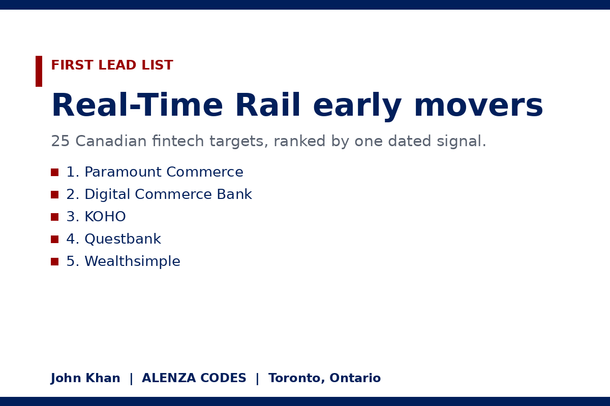

# Real-Time Rail Early Movers: a Ranked Lead List

25 Canadian digital banks, fintechs, lenders and payment companies, built in Clay as if I held a go to market seat at Flinks, then ranked by one dated, verified signal: being named on Nov 9, 2026 as an at launch participant on Payments Canada's Real-Time Rail.

## Top five
1. Paramount Commerce
2. Digital Commerce Bank
3. KOHO
4. Questbank
5. Wealthsimple

Why each one ranks where it does, and the next step for each: [lead-list.md](lead-list.md)
Full list of 25 with signal, date and source columns: [lead-list.csv](lead-list.csv)
Clay search prompt, filters and list name: [clay-inputs.md](clay-inputs.md)

Main source: https://www.payments.ca/canada-launches-real-time-rail-bringing-247-payment-infrastructure-national-economy

Built by John Khan, ALENZA CODES, Toronto, Ontario. Public information only; no one on this list has been contacted.
